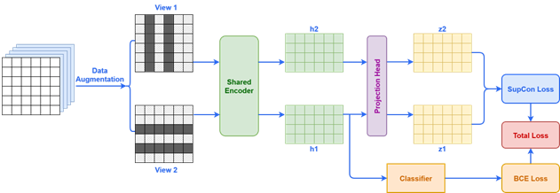

# DP-SCL: Student Dropout Prediction in Online Courses Based on Supervised Contrastive Learning

Official PyTorch implementation of **DP-SCL**, a deep learning framework for predicting student dropout in Massive Open Online Courses (MOOCs) using Supervised Contrastive Learning.

- **Paper:** [Student dropout prediction in online courses based on supervised contrastive learning](https://hjs.huflit.edu.vn/index.php/hjs/article/view/448) (*Dự đoán tình trạng bỏ học của sinh viên trong các khóa học trực tuyến dựa trên học tương phản có giám sát*)
- **Authors:** Doan Van Thanh Phong, Le Khac Toan, Le Van Vinh, Daniel Ambach, Tran Van Lang
- **Journal:** HUFLIT Journal of Science, Vol. 10, No. 4, pp. 1–11, 2026

---

## Model Overview



Each learner–course enrollment record is represented as a temporal activity sequence over 35 days `(5 weeks × 7 days × A activity types)`. **DP-SCL** consists of four main stages:

1. **Data Augmentation:** During training, each input activity sequence is augmented into two stochastic views (`View 1` via temporal masking + Gaussian noise, and `View 2` via feature masking + Gaussian noise).
2. **Shared Temporal Encoder:** Both views pass through a weight-sharing encoder composed of an **LSTM** network, **Multi-Head Self-Attention** (with residual connection and LayerNorm), and **Learnable Query Attentive Pooling** to produce representations $h_1, h_2$.
3. **Projection Head & Supervised Contrastive Loss:** A two-layer MLP projection head with $L_2$ normalization maps $h_1, h_2$ into unit-hypersphere embeddings $z_1, z_2$. **Supervised Contrastive Loss (SupCon)** pulls embeddings of enrollments sharing the same dropout label together while pushing different classes apart.
4. **Classifier & Joint Objective:** An MLP classifier predicts the dropout probability from $h_1$ using Binary Cross-Entropy (`BCEWithLogitsLoss`). During inference, augmentation and the projection head are bypassed, and the model predicts directly from the clean input sequence.

$$\mathcal{L}_{\text{total}} = \mathcal{L}_{\text{BCE}}(\hat{y}, y) + \lambda \cdot \mathcal{L}_{\text{SupCon}}(z_1, z_2, y)$$

---

## Project Structure

```text
.
├── train.py                   # CLI entry point
├── src/
│   └── dpscl/                 # DP-SCL package
│       ├── cli.py             # Command-line argument parsing
│       ├── config.py          # Hyperparameters and model config builder
│       ├── datasets.py        # Dataset metadata (xuetangx, oulad, snap)
│       ├── data.py            # NPZ loading, seeding, and DataLoader creation
│       ├── splits.py          # Stratified train/val/test split helpers
│       ├── experiment.py      # Multi-seed experiment orchestration
│       ├── trainer.py         # Single-seed training and evaluation loop
│       ├── metrics.py         # Threshold selection (Val F1) and evaluation metrics
│       ├── reporting.py       # CSV and text report writers
│       ├── modes.py           # Mode definitions
│       └── model/             # Neural network architecture
│           ├── dp_scl.py      # DPSCLModel, SupConEncoder, ProjectionHead, Classifier
│           ├── layers.py      # AugmentationModule, LearnableQueryPool
│           └── losses.py      # SupConLoss
├── docs/
│   └── DP-SCL.png             # Model architecture diagram
├── tests/
│   └── test_dp_scl.py         # Smoke tests for model forward pass and SupConLoss
├── datastore/                 # Preprocessed .npz dataset files (git-ignored)
└── requirements.txt
```

---

## Installation

```bash
python -m venv venv
venv\Scripts\activate
pip install -r requirements.txt
```

---

## Data Preparation

Place the preprocessed `.npz` dataset files in the `datastore/` directory:

| Dataset | File Path | Shape per Sample `(W, D, A)` |
| :--- | :--- | :--- |
| **XuetangX** (KDD Cup 2015) | `datastore/all_data_std.npz` | `(5, 7, 22)` |
| **OULAD** | `datastore/oulad_data_std.npz` | `(5, 7, 20)` |
| **SNAP MOOC** | `datastore/snap_data_std.npz` | `(5, 7, 6)` |

Each `.npz` file contains `t_data`, `t_label`, `v_data`, and `v_label`. For each random seed, the pipeline combines all records and performs a stratified split (`60% train / 10% validation / 30% test` by default).

---

## Usage

Run the 5-seed experiment (`1, 11, 111, 1111, 11111`) on XuetangX:

```bash
python train.py -indir . -outdir . --dataset xuetangx --max-epochs 200
```

Run on OULAD or SNAP:

```bash
python train.py -indir . -outdir . --dataset oulad --max-epochs 200
python train.py -indir . -outdir . --dataset snap --max-epochs 200
```

Key options:

| Argument | Default | Description |
| :--- | :--- | :--- |
| `--dataset` | `xuetangx` | Dataset choice: `xuetangx`, `oulad`, `snap` |
| `--seeds` | `1 11 111 1111 11111` | Random seeds for stratified splitting & training |
| `--batch-size` | `256` | Training batch size |
| `--lr` | `1e-4` | Adam learning rate |
| `--hidden-size` | `128` | Encoder hidden dimension & projection dimension |
| `--lambda-con` | `0.1` | Weight $\lambda$ for Supervised Contrastive Loss |
| `--temperature` | `0.07` | Temperature $\tau$ for Supervised Contrastive Loss |
| `--mask-ratio` | `0.15` | Masking ratio for temporal and feature views |
| `--noise-std` | `0.05` | Gaussian noise standard deviation |
| `--max-epochs` | `200` | Maximum training epochs |
| `--patience` | `30` | Early stopping patience on Validation AUC |

Outputs (`config.json`, `per_seed_results.csv`, `epoch_history.csv`, `summary_results.csv`, `report.txt`, and `checkpoints/`) are saved to `results/dp_scl_<timestamp>/`.

---

## Citation

If you find this repository useful in your research, please cite our paper:

```bibtex
@article{doan2026dpscl,
  title   = {Student dropout prediction in online courses based on supervised contrastive learning},
  author  = {Doan, Van Thanh Phong and Le, Khac Toan and Le, Van Vinh and Ambach, Daniel and Tran, Van Lang},
  journal = {HUFLIT Journal of Science},
  volume  = {10},
  number  = {4},
  pages   = {1--11},
  year    = {2026},
  url     = {https://hjs.huflit.edu.vn/index.php/hjs/article/view/448}
}
```
